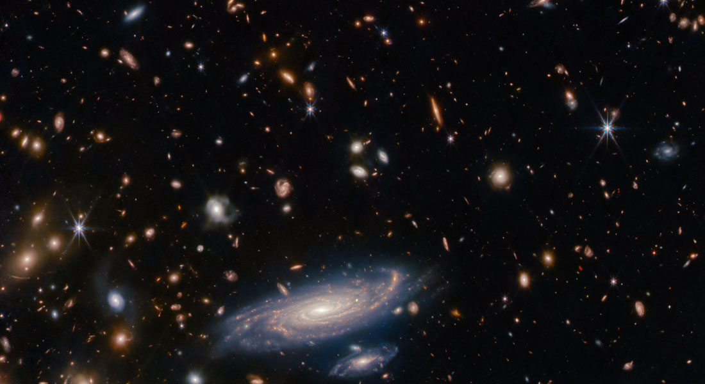

  
# Kasper E. Heintz

I am an Associate Professor at **DTU Space**, the National Space Institute, Technical University of Denmark, where I lead the **Primordial Universe** research group.

I primarily use JWST and ALMA to study how the first galaxies formed and evolved during the first billion years after the Big Bang: their neutral gas reservoirs, the first heavy elements, and the massive stars that drove cosmic reionization.

My group is funded by the **Independent Research Fund Denmark** (2025-2029) and an **ERC Starting Grant** (2026-2031). 

For more information, have a look at my current [research](https://kasperheintz.github.io/research/) activities, [CV](https://kasperheintz.github.io/cv/), the local Primordial Universe [group](https://kasperheintz.github.io/group/), and [outreach](https://kasperheintz.github.io/outreach/) events. 

## Recent news

<!-- Add new items at the top: - **Mon YYYY** — text -->
- **Nov 2026** — New website online.
- **Aug 2026** — Awarded an ERC Starting Grant for the PRIMORDIAL project.
- **Jun 2026** — Granted the A&A Award for Outstanding Early Career Researcher Article 2026.
- **Feb 2026** — Employed as Associate Professor on the faculty at DTU Space.
- **Aug 2025** — Awarded a DFF Sapere Aude research leader grant.

## Open positions

I am always happy to hear from prospective students and Postdocs interested in joining my group. [Get in touch](mailto:kelhe@space.dtu.dk).
