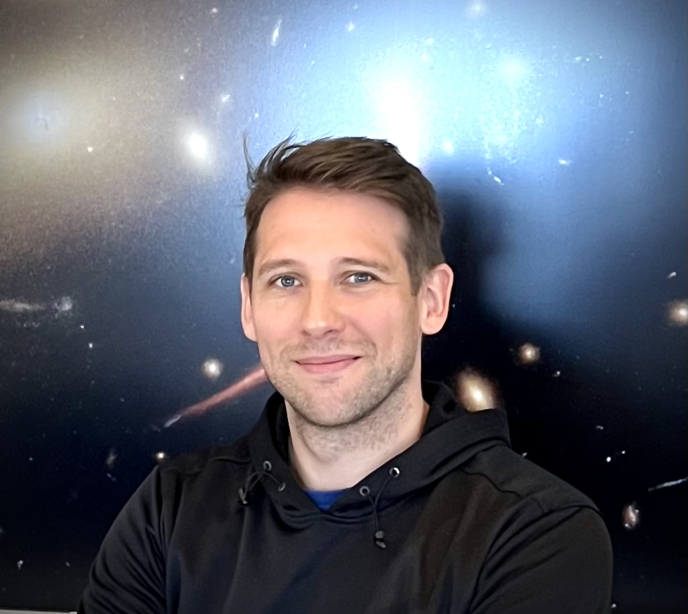

# Kasper E. Heintz

I am an Associate Professor at **DTU Space**, the national space institute at the Technical University of Denmark, where I lead the **Primordial Universe** research group.

I primarily use JWST and ALMA to study how the first galaxies formed and evolved during the first billion years after the Big Bang: their neutral gas reservoirs, the first heavy elements, and the massive stars that drove cosmic reionization.

My group is funded by an **ERC Starting Grant** and the **Independent Research Fund Denmark**.

## News

<!-- Add new items at the top: - **Mon YYYY** — text -->
- **Nov 2026** — New website online.
- **2026** — Awarded an ERC Starting Grant for the Primordial Universe group.
- **Feb 2026** — Moved to DTU Space as Associate Professor.

## Open positions

I am always happy to hear from prospective students and postdocs interested in the early Universe. [Get in touch](mailto:kelhe@space.dtu.dk).
