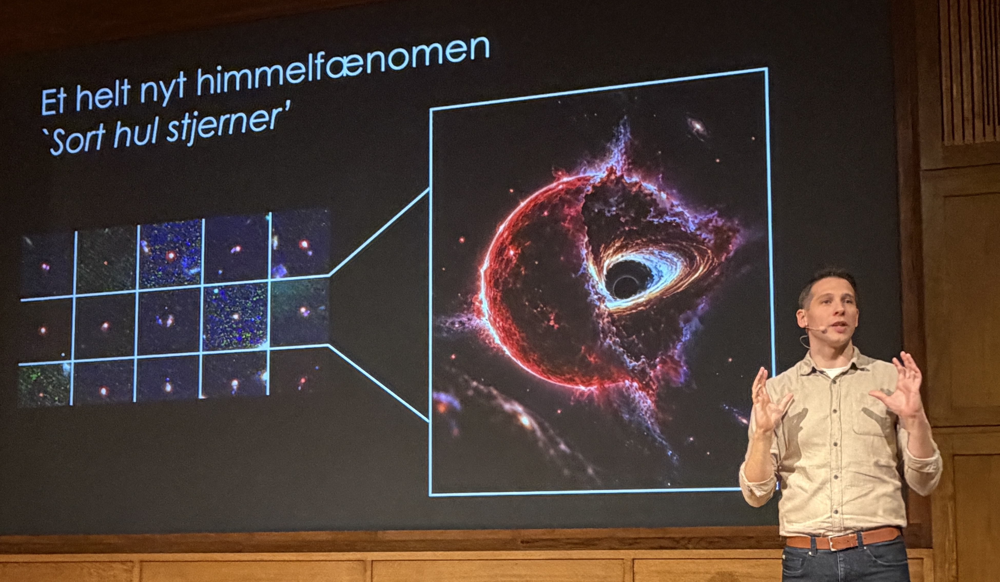
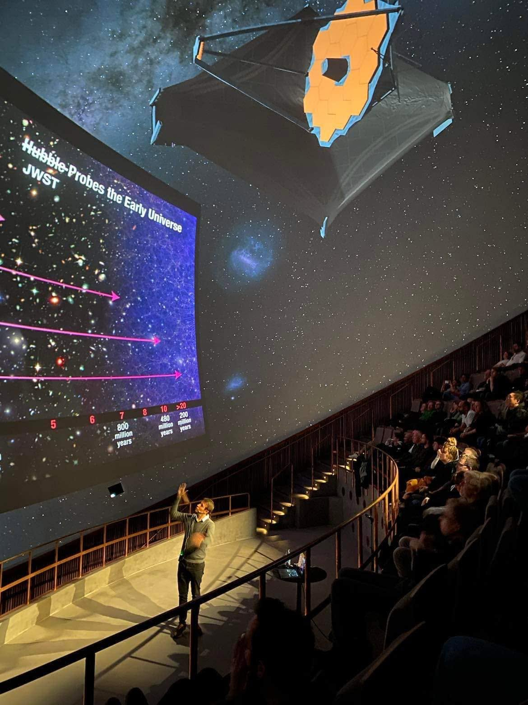

I frequently and greatly enjoy doing various outreach activities (mostly in Danish), including public lectures, podcasts, and more. Most recently I participated in the Science Festival in Copenhagen and Odense hosted by the Independent Research Fond Denmark and Folkeuniversitetet, featured the national morning show Go'Morgen Danmark, gave an invited talk as part of the *Year of the Light* in the Roundtower, and featured in the podcast *Den flyvende tallerken*. Next year I will also join the exciting line up at the [Science Festival in Copenhagen](https://vidensfestival.dk/de-forste-navne-til-vidensfestival-lordag-3-april-2027-peter-viggo-jakobsen-lykke-friis-minik-rosing-michael-bang-anne-marie-engtoft-meldgaard-rebecca-adler-nissen-og-kasper-elm-heintz/).   

## Public talks (in Danish)

I have recently expanded my outreach activities by offering a series of five lectures on the most fundamental aspects of modern astrophysics. Are you curious on where the gold in your ring comes from? Or what actually happened when the first stars lit up the Universe? If so, get in touch to book one of these (all in Danish):

- 🌌 Det Mørke Univers — Når intet bliver til alt, og alt er ting, vi ikke kan se 
- 🧪 Grundstoffernes Astrofysiske Oprindelse — Kosmisk arkæologi og jagten på guld 
- ✨ Da Universet Tændte — Jagten på de første stjerner og galakser 
- ⭐ Ekstreme Stjerner — Og hvordan vi finder dem, fra kanten af Universet til vores egen Mælkevej 
- 🕳️ Sorte Huller — Universets største gåder, hvor tid og rum bryder sammen 

Common to all of them is that I will tell the astronomical story through the questions we actually seek to answer. I will give a unique insight into the research being done, and present the most recent discoveries from the scientific frontier.    

All five can be adapted to anyone from high school students to a more general adult audience, and can be adjuted to from 45, 60, or 90 minutes. If you are looking for a science communicator for public lectures or conferences, devling into the world of astrophysics with both story-telling and the most cutting-edge research, [get in touch](mailto:kelhe@space.dtu.dk)! 

## Recent talks and events (TBD)

<!-- - **Mon YYYY** — Title, venue, city -->
- **Mon YYYY** — Talk title, venue, city

