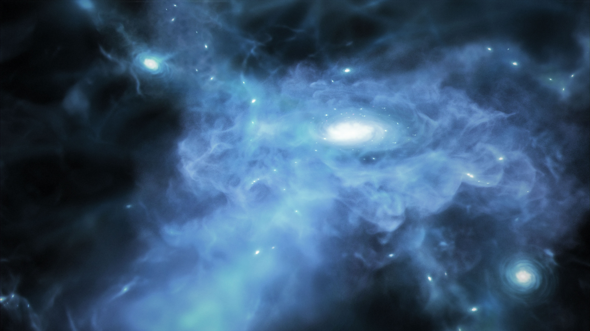
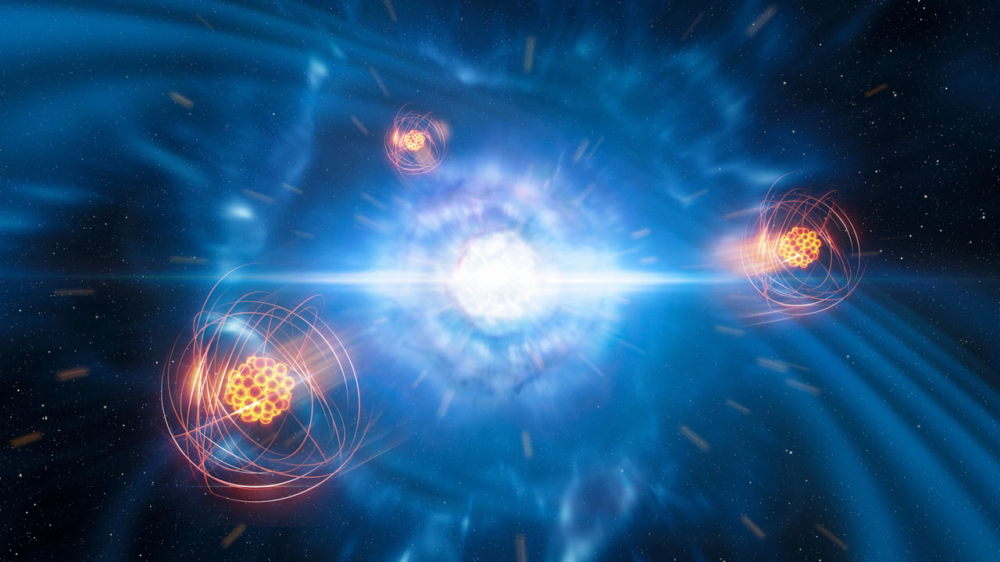
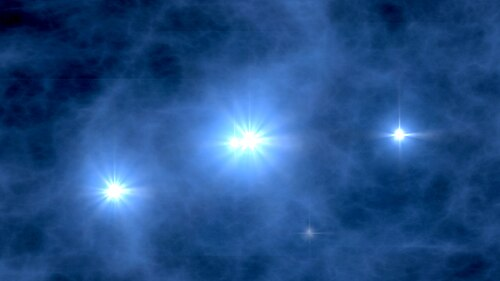

My research focuses on the formation and early evolution of galaxies at cosmic dawn, using mainly observations from the JWST, VLT, and ALMA.

## Neutral gas in the first galaxies

Galaxies grow by accreting cold, neutral hydrogen. With JWST we can now see this gas directly as damped Lyman-α absorption in galaxies only a few hundred million years after the Big Bang, including systems beyond redshift 10. Together with ALMA observations of far-infrared ISM cooling lines, this lets us measure how much fuel early galaxies had and how it was distributed.

## The first heavy elements

The chemical abundances of the earliest galaxies record their stellar ancestors. I study the chemical abundance patterns of early galaxies in absorption and emission, to learn about very massive and short-lived stars, and to place limits on the first, metal-free (Population III) stars.

## Massive stars and reionization

The first generations of massive stars produced the ultraviolet light that reionized the Universe. By examining their stellar light, the ISM conditions under which they formed, and their impact on the ionization and feedback properties of the first galaxies, I look for the direct signatures of these stars to understand their physical properties and origin.

## Earlier work

Before JWST, I worked on transients such as gamma-ray bursts, fast radio bursts and quasars, using them as probes of galaxies and the gas in and around them across cosmic time.
